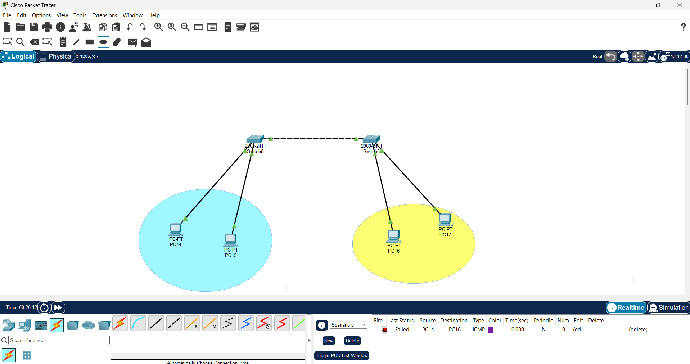
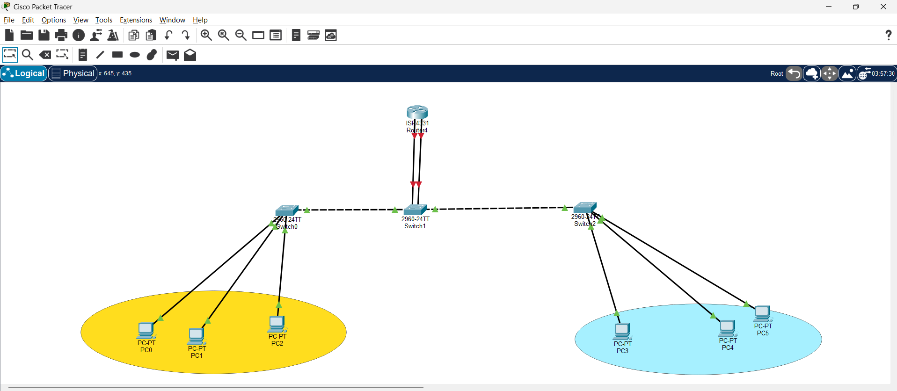

# Experiment 02 · 07/10/26

**Design and Implementation of VLAN Segmentation and Inter-VLAN Routing for a Multi-Department Network using Cisco Packet Tracer**

📅 **Date:** 07/10/26

## Outputs

**Part A**

**Part B**

