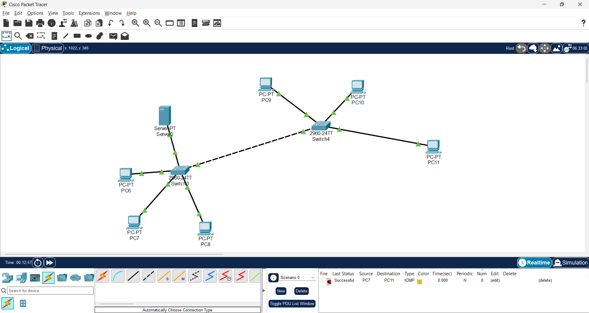
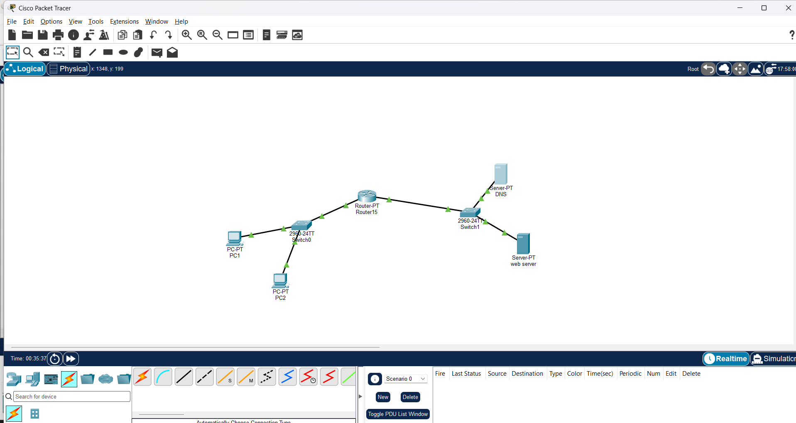
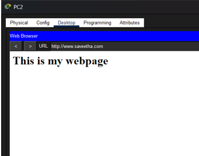

# Experiment 03

**Configuration and Analysis of DNS and DHCP Services for Automated Network Address and Name Management using Cisco Packet Tracer**

📅 **Date:** 07/10/26

## Outputs

**Part A**

**Part B**

